# 01. MICROSERVICES DOMAIN BOUNDARIES & SERVICE ARCHITECTURE
**Standard:** Domain-Driven Design (DDD) Bounded Contexts & Hexagonal Architecture  
**Execution Runtime:** Go 1.24+ Microservices / Modular Distributed Architecture  
**Inter-Service Transport:** gRPC (Protobuf v3) for internal sync, Kafka for async domain events, REST/JSON via API Gateway for external clients.

---

## 1. Domain Bounded Contexts & Data Ownership

```mermaid
graph TD
    GW["API Gateway (Go)"]
    
    subgraph IdentityDomain ["Identity & Security Bounded Context"]
        IS["identity-service"]
        DB_ID[("PostgreSQL: identity")]
        IS --> DB_ID
    end

    subgraph SocialDomain ["Social Graph & Profile Bounded Context"]
        PS["profile-service"]
        SGS["social-graph-service"]
        DB_SOC[("PostgreSQL: social")]
        PS --> DB_SOC
        SGS --> DB_SOC
    end

    subgraph ContentDomain ["Content & Media Bounded Context"]
        POSTS["post-service"]
        MEDIA["media-service"]
        REELS["reels-service"]
        STORIES["stories-service"]
        DB_CNT[("PostgreSQL: content")]
        POSTS --> DB_CNT
        MEDIA --> DB_CNT
        REELS --> DB_CNT
        STORIES --> DB_CNT
    end

    subgraph RealtimeDomain ["Messaging & Realtime Bounded Context"]
        MSG["messaging-service"]
        LIVE["live-service"]
        NOTIF["notification-service"]
        REDIS_RT[("Redis Cluster: Realtime")]
        MSG --> REDIS_RT
        LIVE --> REDIS_RT
    end

    subgraph DiscoveryDomain ["Feed, Discovery & ML Bounded Context"]
        FEED["feed-service"]
        SEARCH["search-service"]
        REC["recommendation-service"]
        OPENSEARCH[("OpenSearch Index")]
        SEARCH --> OPENSEARCH
    end

    subgraph CommerceDomain ["Monetization, Ads & Commerce Bounded Context"]
        ADS["advertising-service"]
        COMM["commerce-service"]
        BILL["billing-service"]
        PAY["payout-service"]
        DB_COM[("PostgreSQL: commerce & ledger")]
        ADS --> DB_COM
        COMM --> DB_COM
        BILL --> DB_COM
        PAY --> DB_COM
    end

    subgraph GovernanceDomain ["Admin & Trust & Safety Bounded Context"]
        MOD["moderation-service"]
        ADM["admin-service"]
        DB_GOV[("PostgreSQL: governance")]
        MOD --> DB_GOV
        ADM --> DB_GOV
    end

    GW --> IS
    GW --> PS
    GW --> SGS
    GW --> POSTS
    GW --> MEDIA
    GW --> REELS
    GW --> STORIES
    GW --> MSG
    GW --> NOTIF
    GW --> FEED
    GW --> SEARCH
    GW --> ADS
    GW --> COMM
    GW --> ADM
```



---

## 2. Data Ownership Rules
1. **Zero Cross-Database Querying**: A service may NEVER directly join or query another service's database tables. All cross-domain data enrichment occurs via gRPC calls or replicated read-models populated by Kafka events.
2. **Transactional Outbox Pattern**: State mutations and their corresponding domain event emissions are written in the same local database transaction:
   ```sql
   BEGIN;
   INSERT INTO posts (...) VALUES (...);
   INSERT INTO outbox_events (event_id, event_type, payload, status)
   VALUES (uuid_generate_v7(), 'PostCreated', '{"post_id": "..."}', 'PENDING');
   COMMIT;
   ```
3. **Idempotent Consumers**: Every consumer tracks processed `event_id` in Redis with a 7-day TTL to guarantee exactly-once processing semantics over Kafka at-least-once delivery.

---

## 3. Core Domain Event Taxonomy

| Event Name | Producer Service | Payload Summary | Primary Consumers |
|---|---|---|---|
| `UserRegistered` | `identity-service` | `user_id, email, username, created_at` | `profile-service`, `notification-service` |
| `PostCreated` | `post-service` | `post_id, author_id, media_urls, tags, created_at` | `feed-service`, `search-service`, `moderation-service` |
| `PostLiked` | `post-service` | `post_id, user_id, author_id, timestamp` | `notification-service`, `recommendation-service` |
| `FollowCreated` | `social-graph-service` | `follower_id, following_id, timestamp` | `feed-service`, `notification-service` |
| `StoryCreated` | `stories-service` | `story_id, author_id, expires_at, is_close_friends` | `feed-service`, `moderation-service` |
| `MessageSent` | `messaging-service` | `message_id, conversation_id, sender_id, recipient_ids` | `notification-service`, `analytics-service` |
| `AdImpressionTracked` | `advertising-service` | `impression_id, ad_id, user_id, placement, bid_cost` | `billing-service`, `analytics-service` |
| `OrderPaid` | `commerce-service` | `order_id, buyer_id, merchant_id, amount, sku` | `billing-service`, `payout-service`, `notification-service` |
| `ContentReported` | `moderation-service` | `report_id, content_type, content_id, reporter_id, reason` | `moderation-service` (Triage Worker) |
