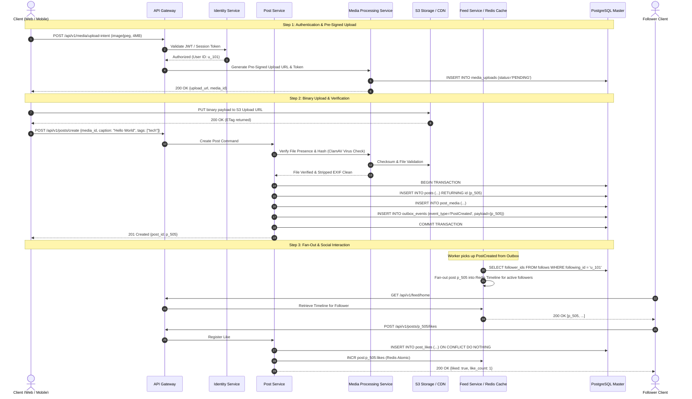

# 03. END-TO-END USER FLOWS SPECIFICATION
**Standard:** Enterprise Workflow Verification (Normal, Edge, Failure, Offline, Recovery)  
**Covered Core Journeys:**
- **Journey A**: Social Feed & Post Lifecycle
- **Journey B**: Reels Ingestion, Transcoding & Engagement
- **Journey C**: Stories Publishing, Interaction & 24h Expiry
- **Journey D**: Direct Messaging, Ephemeral Chat & Blocking
- **Journey E**: Trust & Safety Reporting, Moderation & Appeals
- **Journey F**: Creator Marketplace, Branded Collaboration & Ads
- **Journey G**: Commerce, In-Content Product Tagging & Fulfillment

---

## 1. User Journey A — Social Feed & Post Lifecycle

### Failure & Edge Case Handling:
1. **Network Disruption during Upload**: Upload intent URLs have 15-minute TTL. Client tracks bytes uploaded via resumable headers; retry sends byte offset rather than restarting from zero.
2. **Malware / Invalid MIME Type**: Media Worker flags MIME mismatch or infected file; DB marks `status='REJECTED'`. Post creation fails with `422 Unprocessable Entity (ERR_MEDIA_UNSAFE)`.
3. **Double Click / Idempotency**: `Idempotency-Key` header stored in Redis with 60-second lock prevents duplicate posts or like increments.

---

## 2. User Journey B — Reels Ingestion & Vertical Experience

1. **Client Trimming & Compression**: Client captures 1080x1920 9:16 video. Client validates max duration (90 seconds).
2. **Chunked Resumable Ingestion**: Uploaded via S3 Multipart Upload.
3. **Asynchronous Transcoding Worker**:
   - Master MP4 converted into HLS multi-bitrate streams: 1080p, 720p, 480p, 360p (H.264 / AAC).
   - Generates 3 candidate poster thumbnails.
   - Status updated in PostgreSQL: `READY`.
4. **Recommendation Injection**: Reel metadata and embedding features ingested into OpenSearch and Redis Candidate Pool.
5. **Autoplay & Infinite Swiping**:
   - Mobile and Web prefetch next 2 Reel HLS manifests (`.m3u8`) in background thread.
   - Analytics ping emitted at 25%, 50%, 75%, 100% watch completion for recommendation ranking update.

---

## 3. User Journey C — 24-Hour Stories & Highlights

1. **Publishing**: Ephemeral story published with expiration `expires_at = now() + interval '24 hours'`.
2. **Audience Filtering**:
   - If `story.is_close_friends == true`, only users in `close_friends` table can fetch story payload.
3. **Automated Expiry Engine**:
   - Periodic cron / Temporal workflow flags stories past `expires_at`.
   - Story moved from active Redis feed to `story_archives`.
   - Content no longer accessible via public API; CDN edge cache invalidated.
4. **Highlight Creation**:
   - User selects archived stories from private archive.
   - Creates Highlight with custom title and cover image.
   - Highlight publicly viewable on user's profile subject to account privacy status.

---

## 4. User Journey D — Direct Messaging & Real-Time Sync

1. **Connection**: Client establishes persistent WebSocket with API Gateway (`/api/v1/ws/connect?token=...`).
2. **State Transition**:
   - Client sends message `m_1` with client message ID.
   - Gateway verifies receiver has not blocked sender.
   - Server acknowledges receipt `ACK_SERVER(m_1, server_timestamp)`.
   - Message pushed to recipient's live WebSocket.
   - Recipient client emits `DELIVERED(m_1)`.
   - When recipient scrolls thread into viewport, emits `READ(m_1)` -> Seen indicator displayed to sender.
3. **Offline Synchronization**: If recipient is offline, Gateway enqueues APNs/FCM push notification with masked payload preview. Upon reconnection, client fetches delta via `GET /api/v1/messages/sync?since_seq=...`.
4. **Block Enforcement**: If User B blocks User A, any subsequent messages from User A fail with `ERR_RECIPIENT_UNAVAILABLE`. No historical conversations deleted, but all outgoing signals muted.

---

## 5. User Journey E — Trust & Safety Reporting & Appeals

1. **User Submission**: User taps "Report" -> selects category (Spam, Harassment, Hate Speech, Illegal).
2. **Case Ingestion**: `moderation_cases` created. Automated AI scanner scores severity. High risk escalates to immediate quarantine.
3. **Moderator Decision**: Operations Moderator in Admin Center inspects context, approves or rejects sanction (Content Removed, Account Warning, Temporary Ban, Permanent Suspension).
4. **Transparency & Appeal**: Sanctioned user receives in-app notification with violation rule. User submits appeal within 14 days. Senior moderator or distinct reviewer reviews appeal; if granted, content/account restored with audit trail.

---

## 6. User Journey F — Branded Collaboration & Creator Marketplace

1. **Brand Discovery**: Advertiser searches Creator Marketplace filtered by engagement rate, follower niche, country.
2. **Proposal & Contract**: Brand issues Campaign Proposal specifying deliverable (1 Reel + 1 Story), price ($2,000), and usage dates.
3. **Creator Acceptance**: Creator reviews proposal, accepts terms, generating binding `collaboration_contract`.
4. **Draft Submission & Review**: Creator uploads draft content in Partner Studio. Brand reviews and approves watermarked draft.
5. **Publishing with Disclosure**: Creator publishes live with mandatory `#ad` / `Paid partnership with [Brand]` system badge.
6. **Partnership Ad Code**: Creator toggles "Allow brand partner to boost". Brand inputs code in Ads Manager to run ad spend behind creator's organic handle.

---

## 7. User Journey G — Commerce & Product Tagging

1. **Catalog Setup**: Verified merchant uploads product catalog with SKU, inventory count, price, and variant attributes.
2. **In-Content Product Tagging**: In post/reel composer, creator/merchant taps photo to place product pin on coordinate (x: 45%, y: 62%).
3. **Consumer Discovery**: User taps tagged post -> Product Detail Sheet opens with merchant rating, stock availability, and specs.
4. **Order Placement & PG Checkout**: User selects variant, enters shipping address, signs payment token via PG.
5. **Inventory Lock**: Atomic PostgreSQL update:
   `UPDATE inventory SET stock = stock - 1 WHERE sku = :sku AND stock >= 1;`
6. **Fulfillment & Refund**: Merchant marks "Shipped" with carrier tracking number. If return requested within 14 days, return flow generates dispute ticket and adjusts merchant payout balance.
